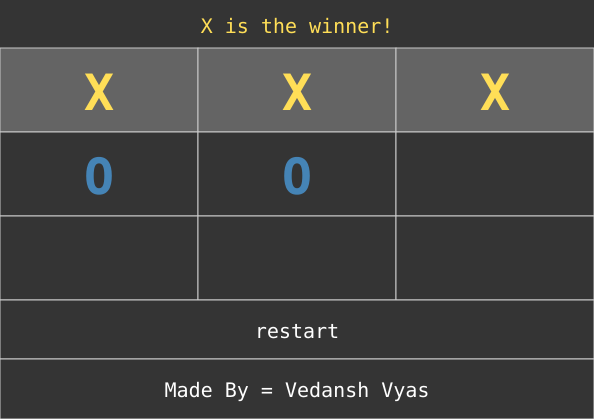

# Tic Tac Toe

A two-player Tic Tac Toe game with a Tkinter GUI. X goes first; click a
square to place your mark. The game detects wins and ties, highlights the
winning line, and has a restart button.

## What it looks like

Board after a live run — X wins the top row. The app is a Tkinter desktop
window, so this is an SVG re-drawn from the game's actual widget state
during a scripted run (real button clicks, under Xvfb), not a photograph:



## Run it

```bash
python tictactoe.py
```

No third-party packages needed — Python 3 with Tkinter (ships with standard
CPython on Windows/macOS; on Debian/Ubuntu you may need
`sudo apt install python3-tk`).

## How to play

- X and O take turns clicking empty squares.
- First to get three in a row, column, or diagonal wins; the winning line
  turns yellow and the banner announces the winner.
- A full board with no winner is a tie.
- **restart** clears the board for a new game.
- **Made By = Vedansh Vyas** randomises the window background colour.
